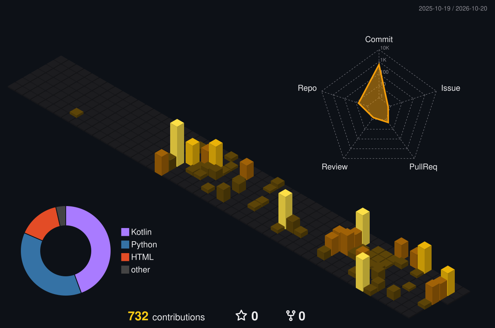

<!--
  README DE PERFIL — Juan Duarte Moura
  Tema: preto + dourado (as cores do VisuAll).
  Banner, texto digitando e rodapé são SVGs do próprio repo (pasta assets/),
  então não dependem de serviço externo. Os cards do bloco "GitHub Analytics"
  dependem de serviços gratuitos: se algum cair, é só apagar a linha dele.
-->

<div align="center">


</div>

---

## 🤖 JUAN AI CORE

```bash
╭──────────────────────────────╮
│    JUAN.SYSTEM  v2026.2      │
╰──────────────────────────────╯

Initializing system...

████████████████████ 100%

✔ Mechatronics background loaded
✔ Computer vision module online
✔ Full-stack engine activated
✔ VisuAll mounted

STATUS: ONLINE 🚀
```

---

## 👨‍💻 About Me

```python
class JuanDuarte:
    def __init__(self):
        self.name       = "Juan Duarte Moura"
        self.role       = "Software Engineering Student @ FIAP"
        self.background = "Mechatronics Technician (ETEC)"
        self.location   = "São Paulo, Brazil 🇧🇷"
        self.focus      = ["Full-Stack Dev", "AI / Computer Vision", "Automation"]
        self.stack      = {
            "languages": ["Python", "JavaScript", "TypeScript", "C++", "HTML", "CSS"],
            "web":       ["React", "Node.js"],
            "ai":        ["OpenCV", "MediaPipe", "TensorFlow", "Keras", "scikit-learn"],
            "hardware":  ["Arduino", "ESP32", "Fusion 360"],
        }
        self.seeking    = "Software Engineering Internship (Estágio)"
        self.fun_fact   = "I built a robotic hand controlled by a webcam"

    def current_mission(self):
        return "Turning hardware-software integration into great software."
```

Sou um desenvolvedor com base sólida em engenharia, migrando do mundo de
**robótica e sistemas embarcados** para o **desenvolvimento de software moderno**.
A formação em mecatrônica me deixa confortável na ponte entre o código e o mundo
físico — de pipelines de visão computacional a aplicações web full-stack.

---

## ⚡ Tech Stack

<div align="center">


<br/><br/>


</div>

---

## 🚀 Featured Projects

### 🤟 VisuAll — reconhecimento de Libras em tempo real


Sistema que reconhece Libras pela câmera e traduz em tempo real, aproximando
pessoas surdas e ouvintes. Funciona no celular e também em **óculos inteligentes
com ESP32**, que fazem a mesma leitura e deixam a conversa com as mãos livres.

Desenvolvido em equipe no **Challenge FIAP 2026**, em parceria com a **JOVI** —
o VisuAll é um dos **6 finalistas do NEXT** (24/10/2026).

<br clear="left"/>

| 🟡 Função | 💡 O que faz |
|---|---|
| 🔤 **Modo Alfabeto** | Reconhece a soletração completa, de A a Z, incluindo as letras com movimento |
| 🧍 **Modo Corpo** | Reconhece sinais pelos pontos do corpo, rosto e mãos: *computador*, *ajuda*, *pessoa*, *surda* e *conversar* |
| 🗣️ **Resposta por voz** | Quem ouve fala ou digita e o texto aparece para a pessoa surda ler; dá para girar a tela e aumentar a letra |
| 🕘 **Histórico** | Guarda o que já foi dito na conversa |
| 👓 **Óculos (ESP32)** | Alterna entre a câmera do celular e a dos óculos; com a tela bloqueada, o celular fica no bolso e o áudio da tradução sai pelo fone ou pela haste |

**Por baixo do capô:** alfabeto com modelos MLP estáticos e dinâmicos · sinais corporais com
MediaPipe Holistic + LSTM · backend e frontend unificados · calibração facial adaptativa ·
frases montadas por lista de tokens.

`Python` · `TensorFlow/Keras` · `MediaPipe` · `scikit-learn` · `WebSocket` · `Kotlin` · `ESP32`

[**→ Ver projeto**](https://github.com/Juanduarte050508/VisuAll)

<br/>

| 🚀 Project | 💡 Description | 🛠️ Stack |
|---|---|---|
| 🤟 [**VisuAll**](https://github.com/Juanduarte050508/VisuAll) | Reconhecimento de Libras em tempo real, no celular e em óculos inteligentes | Python · TensorFlow · MediaPipe |
| 🦾 [**Robotic Hand**](https://github.com/Juanduarte050508/Engineering-Portfolio) | TCC de Mecatrônica: mão robótica controlada por webcam, com 5 servos acionados por Arduino. O precursor do VisuAll | Python · OpenCV · Arduino C++ · Fusion 360 |

---

## 🧠 Current Mission

```bash
> Loading objectives...

[██████████] VisuAll — FIAP Challenge 2026 / NEXT

[████████░░] Full-Stack JavaScript (React + Node + Express)

[███████░░░] Machine Learning & Computer Vision

[█████░░░░░] Estágio em Engenharia de Software

STATUS:
Never stop learning 🚀
```

---

## 📊 GitHub Analytics

<div align="center">


<br/>


<br/>



</div>

---

## 🐍 Contribution Animation

<div align="center">


</div>

---

## 🌎 Connect With Me

<div align="center">

<a href="https://github.com/Juanduarte050508"></a>
<a href="https://www.linkedin.com/in/juan-duarte-moura"></a>
<a href="mailto:juanduarte0505008@gmail.com"></a>

</div>

---

<div align="center">

### 💛 "From the physical to the digital — building things that work."


</div>


