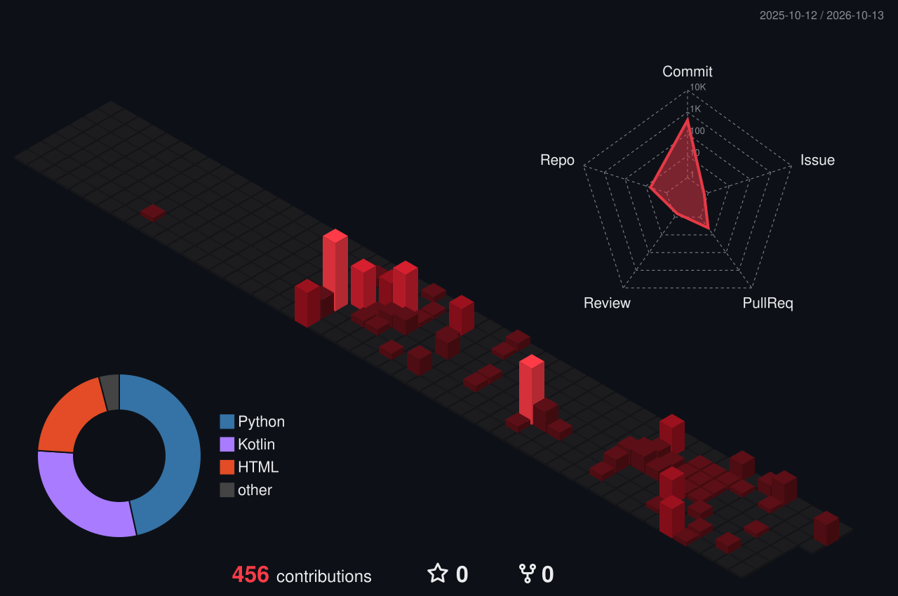

<!--
  README DE PERFIL — Juan Duarte Moura
  Conceito: o perfil é o visor de uma câmera; cada seção é um "frame".
  Arquivos locais (pasta assets/): banner.svg, typing.svg, divider.svg,
  shutter.svg e visuall-logo.png — todas as animações são SVG do próprio repo.
-->

  

  

  
  
  
  

### `[ FRAME 01 ]` &nbsp;sobre mim

| | |
|---|---|
| 🎓 **Graduação** | Engenharia de Software na **FIAP** |
| 🔧 **Formação técnica** | Técnico em **Mecatrônica** pela **ETEC** |
| 📍 **Localização** | São Paulo, Brasil |
| 🎯 **Foco** | Full-Stack · IA / Visão Computacional · Automação |
| 💼 **Em busca de** | Estágio em Engenharia de Software |

Sou um desenvolvedor com base sólida em engenharia, migrando do mundo de
**robótica e sistemas embarcados** para o **desenvolvimento de software moderno**.
A formação em mecatrônica me deixa confortável na ponte entre o código e o mundo
físico — de pipelines de visão computacional a aplicações web full-stack.

### `[ FRAME 02 ]` &nbsp;projetos

<b>🤟 VisuAll</b> — reconhecimento de Libras em tempo real &nbsp;<code>confiança: 0.99</code>

 

Sistema que reconhece Libras pela câmera e traduz em tempo real, aproximando
pessoas surdas e ouvintes. Funciona no celular e também em **óculos inteligentes
com ESP32**, que fazem a mesma leitura e deixam a conversa com as mãos livres.
Desenvolvido em equipe no **Challenge FIAP 2026**, em parceria com a **JOVI** —
o VisuAll é um dos **6 finalistas do NEXT** (24/10/2026).

 

**Como funciona**

- 🔤 **Modo Alfabeto** — reconhece a soletração completa, de A a Z, incluindo as letras com movimento
- 🧍 **Modo Corpo** — reconhece sinais pelos pontos do corpo, rosto e mãos, com as palavras-chave *computador*, *ajuda*, *pessoa*, *surda* e *conversar*
- 🗣️ **Resposta por voz** — quem ouve fala ou digita e o texto aparece para a pessoa surda ler, com opção de girar a tela para aumentar a letra
- 🕘 **Histórico** — guarda o que já foi dito na conversa
- 👓 **Óculos** — alterna entre a câmera do celular e a dos óculos; com a tela bloqueada, o celular fica no bolso enquanto os óculos fazem a leitura e o áudio da tradução sai pelo fone ou pela haste

**Por baixo do capô**

- 🧠 **Alfabeto** com modelos MLP estáticos e dinâmicos
- 🦴 **Sinais corporais** com MediaPipe Holistic + LSTM
- 🔗 Backend e frontend unificados, calibração facial adaptativa e frases montadas por lista de tokens

`Python` `TensorFlow/Keras` `MediaPipe` `scikit-learn` `WebSocket` `Kotlin` `ESP32`

[**abrir repositório ↗**](https://github.com/Juanduarte050508/VisuAll)

<b>🦾 Robotic Hand</b> — mão robótica controlada por visão computacional &nbsp;<code>confiança: 0.97</code>

 

Projeto final (TCC) do curso técnico em Mecatrônica. Uma webcam captura os pontos de
referência da mão em tempo real via OpenCV/MediaPipe, e um Arduino reproduz os
movimentos em 5 servomotores. Foi o precursor direto do VisuAll.

`Python` `OpenCV` `MediaPipe` `Arduino C++` `Fusion 360`

[**abrir repositório ↗**](https://github.com/Juanduarte050508/Engineering-Portfolio)

### `[ FRAME 03 ]` &nbsp;tecnologias

**Linguagens** 

**IA e Visão Computacional** 

**Web** 

**Hardware e Modelagem 3D** 

**Ferramentas** 

### `[ FRAME 04 ]` &nbsp;atividade

  

### `[ FRAME 05 ]` &nbsp;próximos passos

- 🔭 Finalizar o **VisuAll** para o Challenge 2026 da FIAP e apresentá-lo no **NEXT**
- 🌱 Aprofundar **Full-Stack JavaScript** (React + Node + Express)
- 💼 Conquistar meu primeiro **estágio** em Engenharia de Software
- 🤝 Colaborar em projetos de **IA / Visão Computacional**

 

<i>"From the physical to the digital — building things that work."</i>

  

